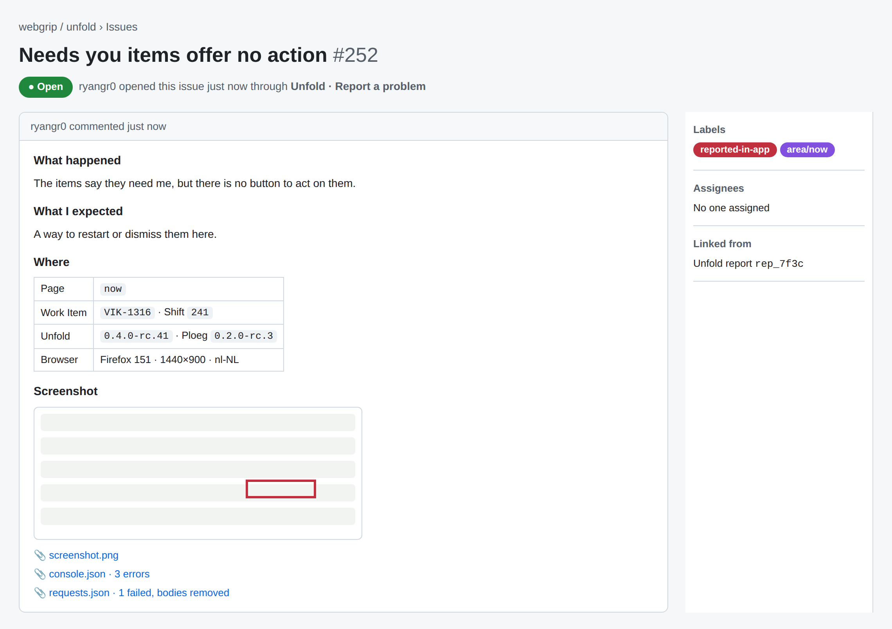
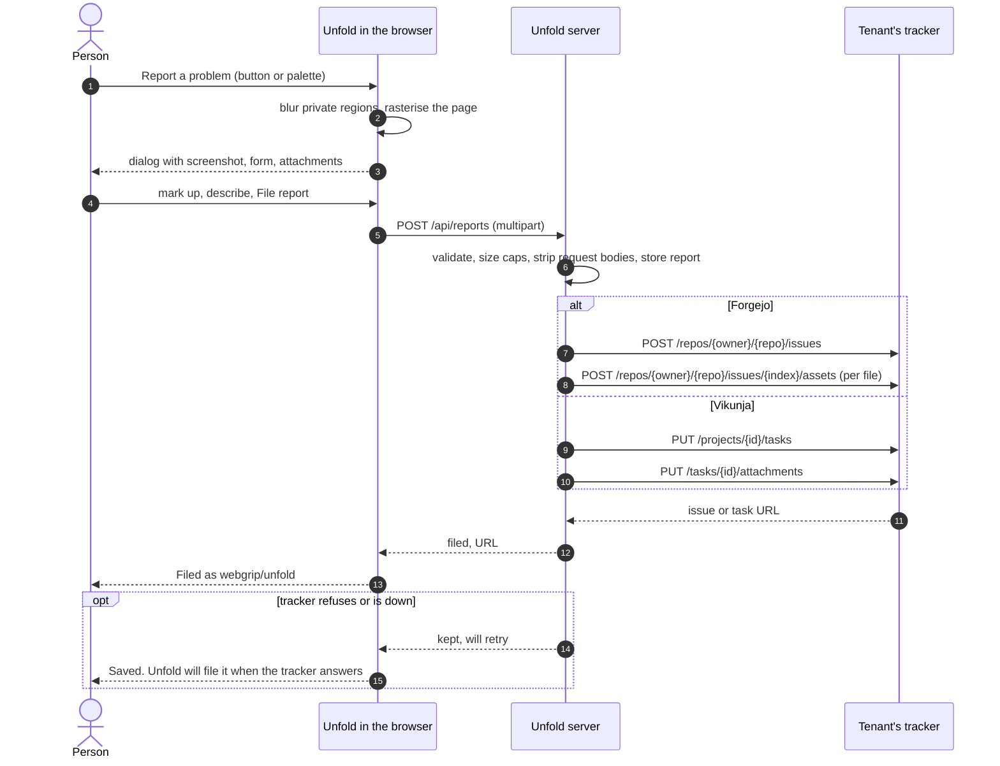

# RFC-0002: Report a problem

> Status: **Accepted** 2026-10-05 · Date: 2026-10-05 · Decision: [ADR-0024](../adr/adr-0024-bug-reports-are-filed-by-unfold-into-the-tenants-own-tracker.md) · Research: [product insight tooling](../research/2026-10-05-product-insight-tooling.md), [bug-reporting evidence](../research/evidence/2026-10-05-product-insight/bug-reporting.md)
>
> **TL;DR.** One button and one palette command. The browser takes a DOM screenshot with code, diffs and pull-request text blurred, lets the person mark it up, and collects recent errors, failed requests and the ids on screen. Unfold's server files it as an issue or task in the tenant's own tracker, with attachments, in two API calls, and shows the link. Nothing is captured in the background, and nothing leaves the install except to the tenant's tracker.

Accepted with its ADR on 2026-10-05. **Built on 2026-10-11 (VIK-1895), in the web application:** the top-bar button and palette command, the screenshot with private regions blurred, the markup canvas, the console and request buffers, `POST /api/reports`, filing into Forgejo and Vikunja with attachments, and the 24-hour retry. The target is set in the configuration (`reports`, see [task connections](../../apps/unfold/docs/operations/task-connections.md)), not yet in a settings screen.

Still proposed: the VS Code extension command, the Settings target screen, GitHub, GitLab and ClickUp filing, and the replay attachment.

What building it changed:

* **html-to-image, not snapdom.** snapdom inserts inline `<style>` elements into the live page to measure it, which `style-src 'self'` blocks, so its capture came out the wrong size. html-to-image writes styles only into its detached copy and works under the unchanged CSP. Unfold builds the `@font-face` rules itself with the fonts inlined, because html-to-image would otherwise resolve relative font URLs by setting a document base URI, which `base-uri 'none'` refuses.
* **The private blur** comes from a constructed stylesheet that applies `filter: blur(6px)` to `[data-private]` for the moment of the copy, rather than a change to the clone.
* **Scrolled pages.** html-to-image lays the copy out unscrolled. The capture shifts back the content of the scrolled window and of each scrolled container, leaves fixed elements in place and moves sticky ones to where they are on screen, so the screenshot shows what the person sees.
* **`data-private`** marks every `<pre>`, every container that renders tracker or pull-request text through `markdown()`, and the diff view. `test/report-client.test.mjs` fails when one is added without it.

**Redesigned on 2026-10-12.** The owner found the first dialog unusable: a shrunken screenshot, three empty boxes of equal weight, plumbing shown as checkboxes. The redesign follows what the in-app reporters that work have in common (Sentry User Feedback, Google Send feedback, Jam, Marker.io, BugHerd, Vercel comments):

* **One required field.** The person picks what kind of report it is (*Something broke*, *Confusing*, *Idea*). The question and its example change with the kind. What they expected and how much it is in their way are optional and only offered for something broken. The title is written from the page and the first sentence, shown as a preview, and editable.
* **Point at it.** With Highlight or Hide, a click on the screenshot boxes or blurs the thing under the pointer, using the page's own layout from the moment the dialog opened. The report names it, for example `button “Approve” in “Delivery gate”`, and never uses text inside `[data-private]`. Dragging still draws a free box.
* **A larger screenshot.** The dialog fills most of the window and the screenshot gets the space the form does not need. Regions blurred automatically are outlined and labelled *Hidden automatically* on screen only, so a blur never looks like a rendering fault.
* **Context without plumbing.** Console messages and failed requests appear only when there are any, with the latest one shown. Page, Work Item, the last pages visited, version, browser and window size are one sentence.
* **Fast and forgiving.** `!` opens it, `H`, `B`, `A` and `T` pick a tool, Ctrl or ⌘ Z undoes, Ctrl or ⌘ Enter files. Text survives an accidental close as a draft in the browser for 7 days. The submit button is never disabled while the screenshot is still being taken; filing waits for it.
* **The loop closes.** After filing, the dialog links the issue, copies the link, and lists the person's earlier reports with their status (`GET /api/reports`, the person's own five).

**Following a report, built on 2026-10-13.** A report that disappears into a tracker teaches people to stop reporting. Two findings shaped this slice: residents of Boston filed more 311 reports after they were shown a photo of a fixed problem, and contributors whose issues a stale bot closed without an answer stopped contributing. So Unfold now follows each filed report and never closes the loop silently:

* **Where it stands, in plain words.** Unfold reads the issue every ten minutes, and again when the person opens their reports. *Got it* until someone acts, *Looking into it* once someone is assigned or comments, *The team replied* when the latest comment is the team's, *Needs more info* when a label asks for it, *Fix in progress* and *Fix merged* from a pull request that names the issue, and *Fixed in 0.4.0-rc.75* once a release of the running Unfold's line, made after the merge, carries the fix. Closing without a fix is *Closed*, *Closed as a duplicate* or *Closed: not planned*, never *Fixed*. The pull request and the release are linked as proof.
* **News comes to the person.** The flag in the top bar gets a dot and a label that counts reports with news, and a toast names the first one, once per stage. *Your reports* (in the dialog header and the palette) lists them with the team's latest comments as plain text, and opening it marks them seen.
* **Answer from Unfold.** Each filed report has a reply box. The reply is posted on the issue by the workbench's tracker account, under the person's name and escaped so it cannot mention anyone. A team question opens the box.
* **Repeats join instead of piling up.** While the person types, Unfold suggests up to three open filed reports from the last 180 days with the same words, preferring the same page, and shows only their titles, stage and how many people hit them. *Same problem* adds the new report to that issue as a comment with its screenshot and files, and the person follows the issue like its first reporter. *Not the same* hides that suggestion for the rest of the report.
* **Every recent request, not only the failed ones.** The request log keeps the last 50 requests with method, path, status and duration, still without queries, headers or bodies, so a slow or empty answer shows up too.
* **An optional acknowledgement.** `reports.acknowledgement` sets one line the success screen shows, such as when the team reads reports. Unfold never invents a response time.

Hover highlighting of the element under the pointer was already part of the redesign. Instant replay stays proposed: it needs the masked recorder from RFC-0001, which is off by default for each tenant.

## What it looks like

1. The screenshot is of the current page, taken in the browser. The person clicks or drags to highlight or hide, and can add arrows and labels.
2. Regions marked private (code, diffs, pull-request text, secrets) are blurred before the person sees the screenshot. They can blur more, never less.
3. Each attachment that has content is listed and can be unticked.
4. The masked 60-second replay appears only on an instance whose tenant has replay switched on, and is unticked by default.

And what lands in the tracker:

## Flow

## Capture in the browser

* **Screenshot.** `@zumer/snapdom` (MIT) rasterises the document to a PNG data URL, which `img-src 'self' data:` already allows. `html-to-image` (MIT) is the fallback if a spike finds snapdom misses Unfold's styles. `getDisplayMedia` is not used, because VS Code webviews do not allow `display-capture`.
* **Private regions.** Components that render code, diffs, pull-request bodies, prompts, logs or secrets set `data-private`. Before rasterising, the clone gets `filter: blur(6px)` on those nodes and a "blurred automatically" tag. A test lists every component that renders such content and fails if one lacks the attribute.
* **Annotation.** An in-house canvas with box, arrow, text, blur and undo, flattened into the PNG. marker.js is not used: its free licence needs a visible link, and its OEM licence (US$ 2,990) covers developer tools.
* **Console.** `console.error`, `window.onerror` and `unhandledrejection` feed a ring buffer of the last 50 entries from the last 10 minutes: message, source file, line and time. Arguments that are objects are summarised by type, not serialised.
* **Requests.** Unfold's own `fetch` wrapper keeps the last 50 requests, failed or not (20 failed ones until 2026-10-13): method, path without query string, status, duration and time. No headers and no bodies.
* **Context.** Route, Work Item, Shift and Run ids on screen, Unfold and Ploeg versions, browser, viewport and locale.
* **Replay.** Only when the tenant's replay setting is on: the last 60 s of the masked recorder from [RFC-0001](rfc-0001-product-events-and-confusion-signals.md), gzip-compressed rrweb JSON.

In the VS Code extension, the palette command "Unfold: Report a problem" opens the same dialog inside the webview. The webview posts the result to the extension host, which calls the server route.

## Route

`POST /api/reports`, multipart: `title`, `happened`, `expected`, `screenshot.png`, `console.json`, `requests.json`, optional `replay.json.gz`. Limits: 8 MB in total, 5 files (Forgejo's default `MAX_FILES`). The server:

1. Checks the session, the tenant's "Report a problem" setting and the CSRF header.
2. Stores the report in a `report` table with status `pending`, so nothing is lost if the tracker fails.
3. Resolves the tenant's report target (below) and files it.
4. Sets status `filed` with the URL, or `failed` with the tracker's answer, and retries `failed` reports with backoff for 24 hours.
5. Records a `report.filed` product event with no text.

The issue body is Markdown in the shape shown above, and gets the label `reported-in-app` when the tracker has it.

## Where reports go

Settings → Insight and feedback names a target per tenant: a provider and a repository or project. It defaults to the tracker source the tenant already uses for work.

| Provider | Create | Attach | Status |
| --- | --- | --- | --- |
| Forgejo | `POST /repos/{owner}/{repo}/issues` (`issueCreateIssue`) | `POST /repos/{owner}/{repo}/issues/{index}/assets` (`issueCreateIssueAttachment`), field `attachment` | first |
| Vikunja | `PUT /projects/{id}/tasks` | `PUT /tasks/{id}/attachments`, field `files` | first |
| GitHub | `POST /repos/{owner}/{repo}/issues` | none in the REST API; the issue links to Unfold's stored copy | later |
| GitLab | `POST /projects/{id}/issues` | `POST /projects/{id}/uploads`, then embed | later |
| ClickUp | `POST /list/{list_id}/task` | `POST /task/{task_id}/attachment` | later |

Unfold's tracker clients in `apps/unfold/src/tasks.ts` read every provider but write only Vikunja comments and assignees. This adds a `createIssue` per provider, with its own tests. The credential is the tenant's existing source credential, which needs issue-write scope. Ploeg's `TrackerProvider` is not changed.

For GitHub, where the API has no attachment upload, Unfold keeps the files and links them from the issue for 90 days.

## Unfold's own reports

Reports about Unfold itself, from the owner's instance, go to `webgrip/unfold` on Forgejo. Repository issue templates (`.forgejo/ISSUE_TEMPLATE/bug.md`) mirror the report's sections, so hand-filed issues look the same.

## Privacy

* The person starts every report and sees every attachment before filing. That is a service the user explicitly asked for, which the research record argues sits outside the need for consent. That is an inference, not a regulator statement.
* No background capture. The console and request buffers live in the page's memory only and vanish on reload.
* The `report` table keeps reports for 90 days after filing, then deletes the files and keeps only the URL.

## Tests

* A browser test files a report into a Forgejo fixture and a Vikunja fixture and asserts the issue, the three attachments and the URL shown.
* A screenshot test renders a page with a diff and asserts the diff region is blurred in the PNG.
* A store test shows a `failed` report is retried and becomes `filed` when the fixture recovers.
* The request buffer test proves no header, query string or body is kept.

## Decided questions

Answered by the owner on 2026-10-05, as proposed.

1. Should Unfold suggest a title from the screen and the first sentence? Decided: yes, editable.
2. Should a report on a Work Item also comment on that Work Item's ticket? Decided: no, the report goes to Unfold's feedback target, not the client's ticket.
