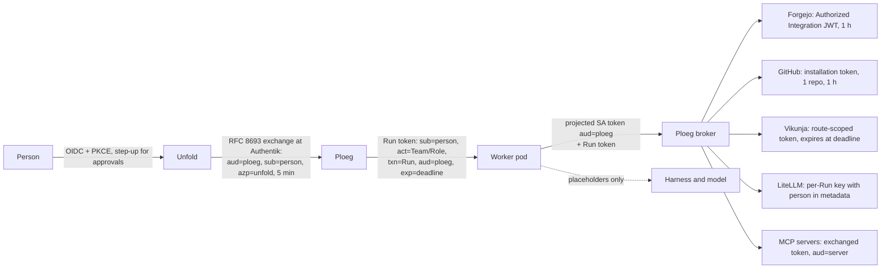

# RFC-0011: Every agent action names its person, with credentials that prove it

> Status: **Proposed** 2026-10-24; owner answered the decisions the same day (see [Owner decisions](#owner-decisions)); stage 1 in review ([homelab-cluster #876](https://forgejo.webgrip.dev/webgrip/homelab-cluster/pulls/876), [#877](https://forgejo.webgrip.dev/webgrip/homelab-cluster/pulls/877)), Forgejo 17 prepared ([#883](https://forgejo.webgrip.dev/webgrip/homelab-cluster/pulls/883)) · Owner request (2026-10-24, about [Connect a repository](../concepts/connect-a-repository.md)): "Is all of this taking into account OBO from authentik? What about all the other recent ways to manage agents identity", then "I want complete integration. And all the other best practices too" · Builds on: Ploeg [ADR-0013](https://github.com/ploeg-hq/ploeg/blob/development/docs/adrs/0013-push-rights-are-minted-per-run.md), [ADR-0034](https://github.com/ploeg-hq/ploeg/blob/development/docs/adrs/0034-the-harness-gets-placeholders-the-worker-keeps-credentials.md), [ADR-0086](https://github.com/ploeg-hq/ploeg/blob/development/docs/adrs/0086-github-is-a-forge-and-a-run-pushes-with-its-own-github-app-installation-token.md), [ADR-0107](https://github.com/ploeg-hq/ploeg/blob/development/docs/adrs/0107-execution-runs-in-cells-that-pull-from-one-hub.md), [ADR-0108](https://github.com/ploeg-hq/ploeg/blob/development/docs/adrs/0108-every-operator-action-names-its-person-and-channel-and-an-mcp-action-needs-the-persons-confirmation.md), [ADR-0138](https://github.com/ploeg-hq/ploeg/blob/development/docs/adrs/0138-a-harness-runs-in-its-own-container-and-no-credential-enters-it.md), [ADR-0143](https://github.com/ploeg-hq/ploeg/blob/development/docs/adrs/0143-a-persons-machine-is-a-personal-cell-and-a-run-gets-a-capability-only-when-its-person-grants-it.md); [Unfold ADR 0016](../../apps/unfold/docs/adrs/0016-sign-in-and-link-your-own-accounts.md) and [0037](../../apps/unfold/docs/adrs/0037-an-editor-signs-in-only-after-its-person-approves-it-and-gets-its-own-credential.md); homelab-cluster ADR-0055 (secrets levels), ADR-0063 and ADR-0068 (agents on Kubernetes), rfc-mcp-identity and rfc-workload-identity-spiffe
>
> **TL;DR.** Today a person is proven only at the edge: Unfold and `ploeg-mcp` verify the person's Authentik token, then call Ploeg with a shared static token and *name* the person in a header that Ploeg cannot check. Below Ploeg every write is a shared bot (`agent-builder`, `bot-ploeg`, the owner's own Vikunja token), and most credentials never expire. This RFC replaces that with one chain in which every hop carries a short-lived token bound to one audience that says **who the person is** (`sub`) and **which agent acts for them** (`act`). The chain has four parts. Unfold exchanges the person's token at Authentik for a Ploeg-audience token (RFC 8693). Ploeg issues each Run a signed Run token shaped like an OAuth Transaction Token. Each worker pod proves itself with its own projected service account token. Ploeg's broker trades those for per-Run credentials at each forge, tracker, model gateway and MCP server, which the agent itself never sees. Consequential actions need a signed, single-use approval bound to the exact action. Commits carry the person as co-author and a link to the Run. The work is split into 7 stages across Ploeg (upstream, consumer-neutral), the homelab cluster (PRs the owner merges) and Unfold. Stage 1, upgrading Authentik to 2026.8.5, is also a security fix.

## What "done" means

An action counts as done here when it meets all of these. The list is the consensus of the 2026 standards and guidance cited under [Sources](#sources); each line says where it comes from.

| # | Property | Means here | Backed by |
| --- | --- | --- | --- |
| P1 | **Attributable** | Every write records the person and the agent acting for them, the Run, the Work Item and, when one was needed, the approval | RFC 8693 §4.1 `act`; OpenID AIIM whitepaper; GitHub `actor_is_agent` |
| P2 | **Proven, not asserted** | The person comes from a signature the receiver verifies, never from a header the caller sets | OWASP Agentic ASI03; Ploeg threat model F-07 |
| P3 | **Short-lived** | Minutes for tokens bound to a person; at most the Run's deadline for Run credentials; nothing in a pod outlives its Run | OWASP NHI7; WIMSE AIMS; MCP 2026-07-28 |
| P4 | **One audience** | Each token is valid at exactly one receiver, which checks `aud` | RFC 9700 §2.3; RFC 8707; MCP authorization |
| P5 | **No pass-through** | A service never forwards the token it received; it exchanges it | MCP authorization ("MUST NOT … transit"); Transaction Tokens |
| P6 | **Least agency** | A credential reaches one repository, one board, one model allowance, one tool set | OWASP LLM06, ASI; NHI5 |
| P7 | **Out of the model's reach** | The harness and the model hold placeholders; real credentials stay in the worker or broker | WIMSE AIMS ("The LLM must not access agent credentials"); Ploeg ADR-0034, 0138 |
| P8 | **Approved when it matters** | A consequential action needs a signed, single-use approval that names actor, tool, target, parameters and expiry; a click alone is not authorization | OWASP AI Agent Security cheat sheet; WIMSE AIMS §10.7 |
| P9 | **Revocable** | Removing a person in Authentik ends their sessions, links and agents within one token lifetime | OWASP NHI1 (offboarding) |
| P10 | **Sender-constrained** | A stolen token is useless without the holder's key | RFC 9700 (SHOULD); RFC 9449 DPoP. *Deferred*, see [Not now](#not-now-and-what-brings-it-back) |

## Where we are

Read on 2026-10-24 from Ploeg `origin/development` b1415c2, Unfold `development` e24182a1 and homelab-cluster `origin/main` ccc4e8cc. Each row names the property it breaks.

| Hop | Today | Breaks |
| --- | --- | --- |
| Person → Unfold (browser) | Authentik OIDC with PKCE; Unfold keeps only the ID token and its own 12 h cookie. Removing someone from the Authentik group does not end their Unfold sessions or editor credentials (30 days) | P9 |
| Person → `unfold-mcp`, `ploeg-mcp` | Authentik JWT, 10 min, verified properly. `aud` is checked against client ids, not the resource (Ploeg F-14) | P4 |
| Unfold, `ploeg-mcp` → Ploeg operator API | One static token per Operator Consumer; the person in `X-Ploeg-Actor` / `X-Ploeg-Acting-User`, format-checked only. `ploeg-mcp` swaps a verified person for a group-shared token. The MCP confirmation state is unsigned (F-08, High) | P1, P2, P8 |
| Worker → Ploeg | Static team/role bootstrap token, then an HMAC run capability valid 24 h | P3 |
| Ploeg → Forgejo | Ploeg holds the `agent-builder` **password** and mints per-Run PATs with no expiry; every commit is `agent-builder@webgrip.dev`. Every worker also boots with the shared `AGENT_BUILDER_TOKEN` (F-30) | P1, P3, P6 |
| Ploeg → GitHub | Per-Run App installation token, one repository, 1 h, revoked at settle. Already right | — |
| Ploeg, Unfold → Vikunja | `bot-ploeg` token valid to 2027; Unfold reads and hands off with the **owner's personal token** | P1, P3 |
| Ploeg, Unfold → LiteLLM | Ploeg holds the master key and mints per-Run keys (2–10 min TTL, budget). The key carries team and role, never the person. Unfold's warm pods share one `UNFOLD_POOL_TOKEN` and can claim each other's assignment, including its model key | P1, P6 |
| Agents → MCP servers | LiteLLM's gateway calls every server with a static credential; Omnigraph uses fixed actor tokens; `k8s-mcp` has no authentication and acts as its own `view` service account | P1, P2 |
| Agents → Kubernetes | Nothing person-bound is deployed; the API server trusts Google only, through the legacy `--oidc-*` flags | P1 |
| Secrets | One External Secrets role reads every path in OpenBao, including the LiteLLM master key | P6 |
| Identity provider | Authentik **2026.5.2**: no token exchange, and missing the fixes of 2026.5.5 and 2026.5.7 (SAML account takeover, delegated-admin escalation to superuser, credentials readable through the API) | all |

The full inventories, with file and line for each hop, are the three read-only reports this RFC was written from; their findings that are not identity-related are filed as tickets, not repeated here.

## The design

### The chain

### 1. Person → Unfold

Unfold stays a confidential backend-for-frontend: the browser holds a cookie, tokens stay on the server. Two changes:

- **Keep the person's access and refresh token** server-side, encrypted, so Unfold can exchange it (step 2). Today it discards them.
- **End sessions when Authentik does.** Unfold registers for OIDC back-channel logout and re-checks group membership when it exchanges a token, so a person removed in Authentik loses browser sessions, editor credentials and `unfold-mcp` access within one access-token lifetime (P9).
- **Step-up before approvals.** An approval (section 6) needs an Authentik login no older than `max_age` with MFA, the flow ADR-0077 already uses for admins.

### 2. Consumer → Ploeg: an exchanged token, not a header

Ploeg's operator API accepts a JWT that an identity provider issued **for Ploeg's audience**, with `sub` the person and `azp` the Operator Consumer. A consumer gets one by RFC 8693 token exchange of the person's token at the identity provider. Ploeg verifies signature, issuer, audience, lifetime (5 minutes or less) and that `azp` is a configured consumer; the person then comes from `sub`, not from `X-Ploeg-Actor`. The consumer token stays as the consumer's own credential for reads it makes as itself, and the headers stay for one release as a fallback that is logged as *asserted*.

In Ploeg's words this is consumer-neutral: "an Operator Consumer acting for a person presents that person's token, exchanged for Ploeg's audience" ([Ploeg knows no consumer](https://github.com/ploeg-hq/ploeg/blob/development/docs/adrs/0069-ploeg-names-none-of-its-consumers.md)). `ploeg-mcp` uses the same path instead of its group-shared tokens, which also closes F-08 if the confirmation (section 6) moves into a signed record.

**`act` from the identity provider.** Authentik 2026.8 issues `act` in the exchanged token when the request carries an `actor_token` (delegation, *on-behalf-of*). That path is in Authentik's open-source core: the `Actor` model, the delegation code and the `act` claim carry no licence check (read at tag `version/2026.8.5`: `providers/oauth2/token/token_exchange.py`, `providers/oauth2/id_token.py`, `core/models.py`). Enterprise adds only the *Agent* layer on top: an API and UI to create Actors, self-service, and grant requests. So each Team gets one Actor in Authentik, **owned** by the Team's sponsor (`parent`), with policy inheritance `none`. Ploeg exchanges with the person's token as `subject_token` and the Team's Actor credential as `actor_token`. The token Authentik returns has `sub` = the person and `act.sub` = the Team, and Authentik's own audit records the call as the Actor acting `on_behalf_of` its owner.

Three rules follow from reading the code, each to be tested before stage 2 relies on it:

- **Never an ownerless Actor.** An Actor without a `parent` is accepted as actor for *any* subject on the JWT path. Deleting a user turns that user's Actors ownerless (`on_delete=SET_DEFAULT`), so offboarding deletes or deactivates their Actors first.
- **Not from a blueprint.** A blueprint can create an Actor but cannot set its `parent`, and the expiry cleanup then deletes it every few minutes. Actors are created by a provisioner Job that runs `ak shell` with `Actor.for_user(owner, ActorPolicyInheritance.NONE, expiring=False)`, in the shape of the cluster's other provisioner Jobs.
- **Revoke by deleting the credential.** Deactivating an Actor may not revoke its API token. Revocation deletes the token, and tokens already exchanged live until they expire (5 minutes or less).

Enterprise ($5 per internal user per month, billed yearly; Actors are not billed) becomes worth it only for the Agents UI and self-service, for example once a second person joins.

### 3. The Run token

When a Run is admitted, Ploeg signs a Run token shaped like an OAuth Transaction Token (draft-ietf-oauth-transaction-tokens-11):

| Claim | Value |
| --- | --- |
| `iss` | Ploeg |
| `aud` | Ploeg's trust domain |
| `sub` | the person the Run acts for: the one who handed the Work Item over, or the tracker user mapped to a person |
| `act` | `{ "sub": "<team>/<role>", "run": "<run id>" }`, and, when an identity provider issued an `act`, that one nested inside |
| `txn` | the Run id |
| `tctx` | Work Item, repository, branch, allowance, isolation class |
| `exp` | the Run's deadline |

It replaces the 24-hour HMAC capability. It is never an access token for anything outside Ploeg: the broker reads it to decide what to mint, and every record Ploeg writes (audit, delivery facts, notes, knowledge) takes `sub` and `act` from it. Ploeg publishes its signing keys on a JWKS endpoint so a consumer can verify a Run's attribution on its own.

When no person handed the work over (a scheduled Run, a tracker task assigned by someone with no mapping), `sub` is the Team's sponsor, a person named in the Team manifest (Ploeg ADR-0110), never a bot. A Run without a sponsor is refused.

### 4. Worker → Ploeg: the pod proves itself

Each worker pod gets a projected service account token with audience `ploeg` and a lifetime of one hour or less, rotated by the kubelet. Ploeg verifies it by TokenReview (or the cluster's JWKS) and checks that the pod's service account matches the Run's Team and Role. The static bootstrap tokens go away. This is the "second step" ADR-0107 already names for cells; a personal cell (ADR-0143) keeps its own key and enrolment.

### 5. Downstream: the broker mints, the agent never sees it

Ploeg's broker trades {pod token + Run token} for one credential per receiver. The worker's proxies keep holding it, and the harness keeps getting placeholders (ADR-0034, 0138).

| Receiver | Credential | Attribution |
| --- | --- | --- |
| **Forgejo** | A Forgejo **Authorized Integration** (Forgejo 16 and later) owned by a bot user per Team, limited to that Team's repositories. Ploeg signs a per-Run JWT with the integration's audience, `exp` one hour or less, and claims the integration's rules pin to the Run's repository. Forgejo verifies it against Ploeg's JWKS. No PAT, no bot password in Ploeg | committer: the Team's bot; `Co-authored-by:` the person; trailers `Ploeg-Run:` and `Work-Item:` with links |
| **Forgejo on 15 LTS** (until the upgrade) | Today's per-Run PAT, but repository-specific (Forgejo 15), its restriction verified after minting (F-10), and the shared `AGENT_BUILDER_TOKEN` removed from workers (F-30). The bot password stays in Ploeg only until Authorized Integrations replace it | as above |
| **GitHub** | Per-Run installation token, one repository, least permissions, 1 h (already built). A user-to-server token only for an action that must appear as the person, such as a review comment they approved, and held by the broker. Token columns sized for GitHub's ~520-character JWT-shaped tokens | as above; matches GitHub's own Copilot pattern |
| **Vikunja** | A token on the Team's `bot-` user (Vikunja 2.4 and later), created per Run with only the routes the Run needs and `expires_at` at its deadline, deleted when the Run settles. Unfold stops using the owner's token: a person's tracker reads use their own link, and hand-offs go through Ploeg | comment footer names the person and the Run |
| **LiteLLM** | Today's per-Run key, plus `user_id` and `metadata {person, run, work_item, team, role}` and the `x-litellm-end-user-id` header, so spend reports by person. The master key leaves Ploeg for a LiteLLM admin key limited to `/key/generate`, `/key/delete` and `/key/block`, if LiteLLM's open-source build allows that; otherwise it stays, and only Ploeg holds it | spend per person |
| **MCP servers** | Each server becomes an OAuth resource server under the MCP revision of 2026-07-28: protected resource metadata, `aud` equals its own audience, scopes, `403 insufficient_scope` for step-up, no pass-through, state handles bound to the person. The broker gets a token per server by exchanging at Authentik with `audience` set to that server's provider. LiteLLM's gateway passes the caller's identity instead of a static credential, or the Run reaches the server directly | the server logs `sub` and `act` |
| **Kubernetes API** | Agents read through ADR-0068: the API server trusts an Authentik audience in a structured `AuthenticationConfiguration`, maps the username to `agent:<email>` and copies `act` into `extra`, read-only. `k8s-mcp` requires OAuth and passes an exchanged token instead of acting as its own service account | `agent:<email>` in the audit log |
| **Omnigraph** | An exchanged token per Run with the graph's audience instead of the fixed `act-*` bearer tokens, once Omnigraph verifies JWTs; until then Ploeg keeps one token and writes `sub`/`act` into every note's provenance (ADR-0122) | note provenance |

### 6. Approvals are signed records

A consequential action pauses the Run and asks a person. Examples: merging, pushing outside the Run's branch, spending above the allowance, writing to production, a tool marked consequential in the Team manifest. The person approves in Unfold, behind step-up, or in their MCP client through elicitation. Ploeg then writes an approval record: who approved, which actor, which tool, which target, a hash of the normalized parameters, and an expiry. Ploeg signs it, and it can be used once. Only then does the broker mint the credential for that one action, and the record's id goes into the audit and the commit trailer. A confirmation that is only a client's word (today's `X-Ploeg-Confirmation` and the unsigned MCP state) is no longer enough.

### 7. Unfold's own sandboxes

Unfold still runs workspaces of its own ([ADR 0023](../../apps/unfold/docs/adrs/0023-unfold-submits-work-to-ploeg-and-never-executes-it.md) retires them; until then they follow the same rules):

- The warm pool hands each pod a claim bound to that pod's projected token, not a shared `UNFOLD_POOL_TOKEN`.
- A clone uses a token minted for that repository and operation, never the person's full GitLab link.
- The workbench's store key moves from a file next to the database to OpenBao (transit).
- ClickUp links use PKCE. Unlinking revokes upstream wherever the provider allows, and logs it when it fails.

### 8. The secrets plane

- External Secrets gets one store per namespace, each with an OpenBao role that reads only that namespace's paths. The cluster-wide role that reads every path goes.
- Long-lived tokens that cannot be minted yet are inventoried with an owner and a rotation date. Today that's Vikunja and Omnigraph, and the webhook secrets until replay protection lands (F-05).
- OpenBao goes to 2.7.1.

## Not now, and what brings it back

| Practice | Why not now | Adopt when |
| --- | --- | --- |
| Sender-constrained tokens (DPoP, RFC 9449; mTLS-bound, RFC 8705) | Authentik binds only ID tokens, Envoy Gateway cannot validate DPoP, and Ploeg serves plain HTTP. Short lifetimes and one audience per token are the compensating control | Authentik binds access tokens; or the cluster gets a mesh, for Ploeg-internal mTLS |
| MCP Enterprise-Managed Authorization (ID-JAG, Cross-App Access) | Authentik has an open PR only (#26973); the grant is still a draft (-04) | Authentik releases ID-JAG |
| Client ID Metadata Documents for MCP clients | Authentik has none; its DCR needs a bearer token, so MCP clients cannot self-register | Authentik ships CIMD; until then MCP clients are registered in Authentik by hand, as `ploeg-mcp` and `unfold-mcp` already are |
| CIBA (approval on the person's phone, initiated by the server) | Authentik does not support it | Authentik ships CIBA; approvals then move from Unfold to the identity provider |
| SPIFFE/SPIRE, WIMSE workload tokens | One cluster; projected service account tokens give the same proof for less | A second cluster or cell site (the Unfold cloud cluster) needs to trust this one's workloads |
| AuthZEN decision service (OpenFGA, Cedar) | Ploeg's rules still fit in code | Team permissions (ADR-0110) outgrow code; Ploeg shapes its checks as AuthZEN requests from now on so the move is mechanical |
| Chained `act` from Authentik | Merged to Authentik's main 2026-10-19, not released | Authentik 2026.11 |
| GitHub App workload federation | Announced 2026-10-13, not released | GitHub releases it; the GitHub App key then leaves Ploeg |
| Claude logins stored for a Team (Ploeg ADR-0112) | Storing a person's Claude login for unattended Runs breaches Anthropic's terms; client-carried Runs and API keys stay the paths | Anthropic offers delegated authorization |

## Plan

Each stage ships on its own and leaves the system working. Ploeg stages are consumer-neutral Ploeg ADRs and pull requests in `ploeg-hq/ploeg`; homelab stages are pull requests the owner merges; Unfold stages adopt a released Ploeg.

| Stage | Where | What | Depends on |
| --- | --- | --- | --- |
| 1 | homelab | **Media to Garage, then Authentik 2026.5.2 → 2026.8.5.** First the media bucket ([#876](https://forgejo.webgrip.dev/webgrip/homelab-cluster/pulls/876)), then the switch, which also drops the shared single-attach volume that made six upgrades fail on 2026-08-03, and moves to rolling updates ([#877](https://forgejo.webgrip.dev/webgrip/homelab-cluster/pulls/877)). Then the upgrade: set `AUTHENTIK_LISTEN__TRUSTED_PROXY_CIDRS` (2026.8 trusts `X-Forwarded-*` only from it) and `AUTHENTIK_WEB__BASE_URL`, lift the OpenTofu provider hold in the same PR, outposts in step | — |
| 2 | Ploeg | ADR + build: operator API accepts an exchanged person token (section 2); `ploeg-mcp` uses it; headers become a logged fallback | — (testable with any OIDC issuer) |
| 2 | homelab | Authentik: enable token exchange on the `unfold` and `ploeg-mcp` providers, a `ploeg` provider as target that lists them as federated, an expression policy on every federated source that checks `iss`, `aud` and `sub` (Authentik checks only signature and expiry there); one owned Actor per Team from a provisioner Job, its credential in OpenBao for Ploeg | 1 |
| 2 | Unfold | Keep the person's tokens server-side; exchange per Ploeg call; back-channel logout; step-up for approvals | Ploeg release with 2, homelab 2 |
| 3 | Ploeg | ADR + build: the Run token (section 3), JWKS endpoint, Team sponsor; the HMAC capability retires | 2 |
| 4 | Ploeg + homelab | Projected service account tokens for workers; bootstrap tokens retire | 3 |
| 5 | Ploeg + homelab | Broker credentials per receiver (section 5): LiteLLM person metadata first (no upgrade needed), then Vikunja per-Run tokens, then Forgejo hardening on 15, then Authorized Integrations once Forgejo is on 16 or later; attribution trailers in every commit | 3 |
| 6 | Ploeg + Unfold | Signed approval records (section 6), replacing `X-Ploeg-Confirmation` and the unsigned MCP state | 3 |
| 7 | homelab + Unfold + Ploeg | MCP servers to the 2026-07-28 revision; structured Kubernetes authentication for ADR-0068; `k8s-mcp` behind OAuth; per-namespace External Secrets stores; OpenBao 2.7.1; Unfold sandbox fixes (section 7) | 1, 2 |

### Test first

Before the stage that relies on it, each of these needs a check against the real component, because the documentation leaves it open:

1. Does Authentik's authorization endpoint reject the `resource` parameter that MCP clients must send? Authentik rejects it on token exchange.
2. Can Ploeg sign JWTs that a Forgejo Authorized Integration accepts? Its audience is a Forgejo-generated `u:<uid>:<uuid>`, and the issuer's discovery and JWKS must be on one host.
3. Exchanged tokens survive revocation of the token they came from. Keep their lifetime at 5 minutes or less and measure it.
4. Can LiteLLM's open-source build mint a limited admin key, or do key permissions need Enterprise?
5. How long are GitHub's JWT-shaped installation tokens in Ploeg's and Unfold's stored fields?

## Owner decisions

Answered by the owner on 2026-10-24.

1. **On-behalf-of from Authentik, without Enterprise.** The owner wants the identity provider to issue `act`. Authentik's open-source core does that with owned Actors (section 2), so Enterprise is not needed for it. Enterprise stays an option for the Agents UI and self-service.
2. **Forgejo 15 LTS → 17: yes.** Prepared in [homelab-cluster #883](https://forgejo.webgrip.dev/webgrip/homelab-cluster/pulls/883). The image moves once 17.0.1 is out, because 17.0.0 has a push and merge regression ([forgejo#14866](https://codeberg.org/forgejo/forgejo/issues/14866)). 17 is supported until 2027-01-28, so 18 and then 19 LTS follow within about six months.
3. **Talos 1.14 with Kubernetes 1.37: yes, later.** Structured Kubernetes authentication (stage 7, [VIK-2383](https://vikunja.webgrip.dev/tasks/2383)) waits for that upgrade; nothing is built through `extraArgs` on 1.36 meanwhile.
4. **Media to Garage first, then the upgrade**, as separate pull requests the owner merges when a restart suits.
5. **The owner sponsors every Team** until a second person joins. A Team without a sponsor runs nothing.

## Sources

- Authentik: [token exchange](https://docs.goauthentik.io/add-secure-apps/providers/oauth2/token_exchange/), [release 2026.8](https://docs.goauthentik.io/releases/2026.8), [release 2026.5 security fixes](https://docs.goauthentik.io/releases/2026.5), [agent accounts](https://docs.goauthentik.io/users-sources/user/account-types/agent-accounts/), [machine-to-machine and federated JWTs](https://docs.goauthentik.io/add-secure-apps/providers/oauth2/machine_to_machine/), [chained `act` PR #26668](https://github.com/goauthentik/authentik/pull/26668), [ID-JAG PR #26973](https://github.com/goauthentik/authentik/pull/26973)
- OAuth: [RFC 8693](https://www.rfc-editor.org/rfc/rfc8693), [RFC 9700](https://datatracker.ietf.org/doc/html/rfc9700), [RFC 9449](https://www.rfc-editor.org/rfc/rfc9449), [RFC 9396](https://www.rfc-editor.org/rfc/rfc9396), [Transaction Tokens -11](https://datatracker.ietf.org/doc/draft-ietf-oauth-transaction-tokens/), [ID-JAG -04](https://datatracker.ietf.org/doc/draft-ietf-oauth-identity-assertion-authz-grant/), [SPIFFE client auth](https://datatracker.ietf.org/doc/draft-ietf-oauth-spiffe-client-auth/)
- MCP: [authorization, 2026-07-28](https://modelcontextprotocol.io/specification/2026-07-28/basic/authorization), [security best practices](https://modelcontextprotocol.io/docs/tutorials/security/security_best_practices), [elicitation](https://modelcontextprotocol.io/specification/2026-07-28/client/elicitation)
- Workload identity and agents: [WIMSE documents](https://datatracker.ietf.org/wg/wimse/documents/), [WIMSE AIMS](https://datatracker.ietf.org/doc/draft-ietf-wimse-aims/), [OpenID AIIM whitepaper](https://openid.net/wp-content/uploads/2025/10/Identity-Management-for-Agentic-AI.pdf), [AuthZEN 1.0](https://openid.net/specs/authorization-api-1_0.html), [CIBA Core](https://openid.net/specs/openid-client-initiated-backchannel-authentication-core-1_0.html)
- OWASP: [Agentic Top 10 2026](https://genai.owasp.org/resource/owasp-top-10-for-agentic-applications-for-2026/), [NHI Top 10](https://owasp.github.io/www-project-non-human-identities-top-10/2025/top-10-2025), [LLM06 Excessive Agency](https://genai.owasp.org/llmrisk/llm062025-excessive-agency/), [AI Agent Security cheat sheet](https://cheatsheetseries.owasp.org/cheatsheets/AI_Agent_Security_Cheat_Sheet.html)
- Forges and tools: [Forgejo Authorized Integrations](https://forgejo.org/docs/latest/user/authorized-integrations/), [Forgejo Actions OIDC](https://forgejo.org/docs/latest/user/actions/security-openid-connect/), [GitHub installation tokens](https://docs.github.com/en/apps/creating-github-apps/authenticating-with-a-github-app/generating-an-installation-access-token-for-a-github-app), [GitHub stateless installation tokens](https://github.blog/changelog/2026-10-02-stateless-github-app-installation-tokens-rolled-out/), [Copilot commit trailers](https://github.blog/changelog/2026-03-20-trace-any-copilot-coding-agent-commit-to-its-session-logs/), [Vikunja OpenID](https://vikunja.io/docs/openid/), [LiteLLM virtual keys](https://docs.litellm.ai/docs/proxy/virtual_keys), [LiteLLM JWT auth (Enterprise)](https://docs.litellm.ai/docs/proxy/token_auth), [Envoy Gateway API](https://gateway.envoyproxy.io/docs/api/extension_types/), [Kubernetes structured authentication](https://kubernetes.io/docs/reference/access-authn-authz/authentication/), [OpenBao JWT auth](https://openbao.org/docs/auth/jwt/)
